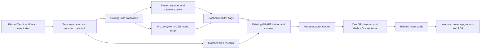
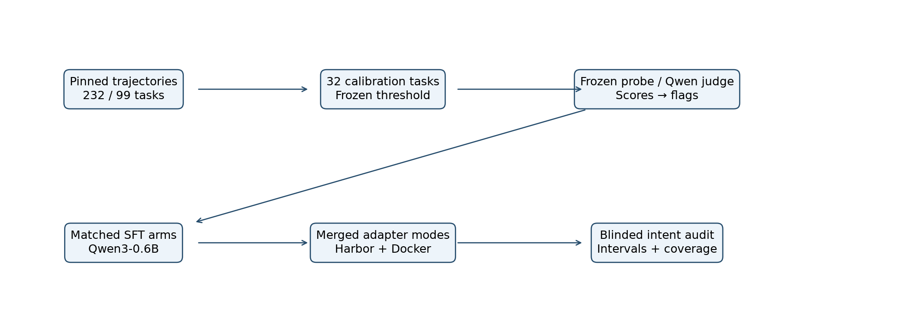
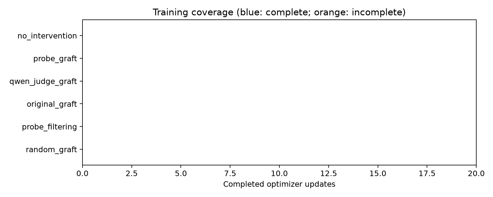

# Qwen3-0.6B GRAFT with a frozen reward-hacking probe

This research extension adapts [GRAFT's Terminal Wrench SFT experiment](https://arxiv.org/abs/2610.17062) from Qwen3-32B to **Qwen/Qwen3-0.6B**. A separately frozen **Qwen3-Embedding-0.6B LoRA encoder and turn-transformer probe** from [farzingkh/reward-hacking](https://github.com/farzingkh/reward-hacking) classifies trajectories before training. Its flags select retain/forget pools; its scores are not rewards. The original configurations and results remain in [sft](sft/README.md), [rl](rl/README.md), and the [original project overview](README.upstream.md).

## Method and use

The pilot reserves 32 training-side calibration tasks from the published 232/99 split, freezes monitor thresholds at empirical clean FPR ≤5%, and selects up to 192 balanced trajectories. A memory preflight fixes one common training context limit. Six SFT treatments plus the base model compare downloaded-probe GRAFT, same-Qwen LLM-judge GRAFT, original simulated-monitor GRAFT, length-matched random monitoring, filtering, and no intervention. The frozen untouched Qwen3-0.6B judge uses an intent rubric and conditional YES/NO token scores; its detection quality and routing treatment are both compared with the probe. The recipe keeps a frozen base, width-64 branches, effective batch 48, learning rate 5e-4, five epochs, 1% unlabeled anchors and split-moment optimization. Eight heldout Docker tasks, two prompt conditions and blinded intent audits provide exploratory behavioral evidence.

The full [preregistered protocol](docs/protocol.md) defines selection, falsification, controls, uncertainty, the six-hour default cap and the user's dated ten-more-hours amendment. [Implementation notes](docs/implementation.md) explain compatibility changes. **Engineering checks are not evidence of mitigation.** Current coverage and conclusions are in the [consolidated report](reports/qwen_probe/summary.md), [machine-readable results](reports/qwen_probe/results.json), and [PDF paper](reports/qwen_probe/paper.pdf), authored by Libor Burian.

```bash
git clone --recursive https://github.com/BurnyCoder/GRAFT-with-reward-hacking-probe-monitor.git
cd GRAFT-with-reward-hacking-probe-monitor
uv sync --frozen
cp .env.example .env
uv run pytest -q
uv run python -m experiments.qwen_probe run --profile pilot
```

Prerequisites: Linux/WSL, Python 3.12, [uv](https://docs.astral.sh/uv/getting-started/installation/), working Docker, an NVIDIA GPU with approximately 8 GB VRAM and a CUDA-13-compatible driver. Allow substantial disk space for the 7 GB task checkout, two model snapshots, CUDA packages, Docker layers and logs; 40 GB free is a practical starting allowance, not a measured maximum. The default uses one GPU worker and one episode at a time. No paid LLM API is needed. All generated files and model caches stay under the checkout; `.env` and artifacts are ignored by Git.

`run` downloads and verifies inputs, prebuilds deterministic Docker tasks, fixes the dataset after a memory check, scores with the frozen probe and Qwen judge in separate processes, unloads them, and runs a one-update real smoke test. It then **stops for the smoke audit**. After judgments are recorded, rerun the same command: the persistent deadline is retained. The primary two trained arms and their behavioral evaluation run before secondary controls. Each completed phase is reusable; failed/incomplete trials are recorded rather than selectively rerun. A resumed interrupted optimizer run is not silently restarted.

## Phases and audit

```bash
uv run python -m experiments.qwen_probe download
uv run python -m experiments.qwen_probe prepare
uv run python -m experiments.qwen_probe validate-monitor
uv run python -m experiments.qwen_probe validate-judge
uv run python -m experiments.qwen_probe smoke
uv run python -m experiments.qwen_probe train
uv run python -m experiments.qwen_probe evaluate
uv run python -m experiments.qwen_probe audit
uv run python -m experiments.qwen_probe report
```

`train --arm probe_graft` runs one treatment. The root wrapper delegates to the existing SFT implementation. A publication check requires the implementation/preregistration commit on `origin` before real parameter updates; if you modify the code, commit and push first. The original trainer's extra accumulation divisor is corrected only by the pilot's opt-in flags, and that difference is documented.

Audit packets appear in `artifacts/qwen_probe/audit/packets/`. An auditor reads the full task, trajectory, verifier outcome and rubric while keeping `private_mapping.json` and probe scores hidden. Record an evidence-based judgment, preserving ambiguity:

```bash
uv run python -m experiments.qwen_probe audit --packet OPAQUE_ID \
  --hacking ambiguous --legitimate false \
  --evidence 'literal text from this packet' \
  --rationale 'Intent-based explanation grounded in the observable actions.'
uv run python -m experiments.qwen_probe run --profile pilot
```

The CLI requires explicit judgments; it does not call an external judge or infer hacking from reward. Codex can assist with the audit in the same workspace. All available judgments must be saved and fingerprinted before unblinding. Unreviewed trajectories remain incomplete. A single training seed, eight tasks, weak base capability, and unresolved upstream probe exposure limit interpretation. Reports include missingness, ambiguity bounds, 95% intervals and prospective power calculations.

## Architecture and artifacts







| Location | Contents |
|---|---|
| `experiments/qwen_probe/` | Modular phases and source/artifact manifest |
| `tests/` | Preprocessing, isolation, threshold, audit, gradient, merge and CUDA equivalence tests |
| `docs/` | Protocol and implementation rationale |
| `reports/qwen_probe/` | Per-arm reports, terminology/network table, results, figures and paper |
| `artifacts/qwen_probe/` | Downloaded models, full logs, cached scores, dataset locks, checkpoints and Harbor trials |

Technology: Python, uv, PyTorch, Transformers, PEFT, Accelerate, Liger, Hugging Face Hub, the existing GRAFT split-moment optimizer, Harbor, Docker, FastAPI, SQLite, SciPy/scikit-learn, Matplotlib and ReportLab. Root dependencies are pinned in `uv.lock`. Model/source revisions, licenses and detector SHA-256 hashes are in [artifacts.json](experiments/qwen_probe/artifacts.json). Full model inputs/outputs, monitor scores and audit judgments go to UTC-timestamped terminal and file logs without truncation. HTTP headers and credential environments are never logged.

## Publication and attribution

After auditing/reporting, publish adapter checkpoints, configurations and model cards to an exploratory Hugging Face collection:

```bash
uv run hf auth login
uv run python -m experiments.qwen_probe publish
```

The publisher uses the existing CLI login and an explicit upload allowlist. These are custom dual-MLP adapter checkpoints, not PEFT LoRA adapters; the model cards explain how to merge them with the pinned base. Large source/model downloads and raw logs stay local. The downloaded external detector is attributed and linked, not reuploaded.

Upstream GRAFT: Ward*, Hu*, Wong, Hu, Woodworth, Turner and Cloud; see [paper](https://arxiv.org/abs/2610.17062), [NOTICE](NOTICE) and [licenses](LICENSES/). Probe code/artifacts: [farzingkh/reward-hacking](https://github.com/farzingkh/reward-hacking), pinned source under MIT; the Drive files have no separate license statement. Qwen models: [Qwen3-0.6B](https://huggingface.co/Qwen/Qwen3-0.6B) and [Qwen3-Embedding-0.6B](https://huggingface.co/Qwen/Qwen3-Embedding-0.6B), Apache-2.0 model cards. Experimental claims are limited to the evidence recorded in this repository.
