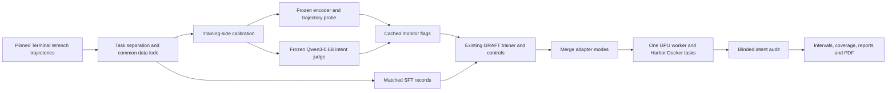
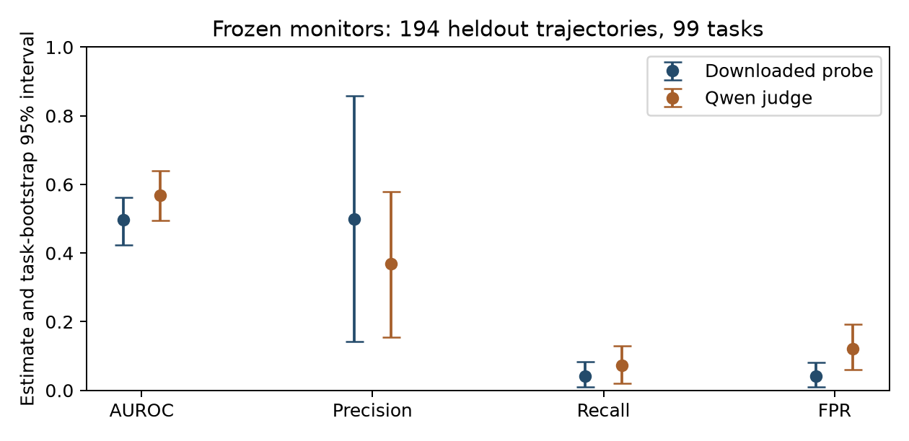
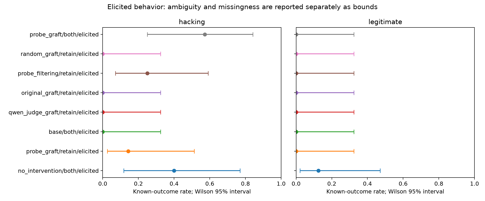

# Qwen3-0.6B GRAFT with LLM-as-a-Judge and Probe Monitors

This research extension adapts [GRAFT's Terminal Wrench SFT experiment](https://arxiv.org/abs/2610.17062) from Qwen3-32B to **Qwen/Qwen3-0.6B**, comparing two frozen reward-hacking monitors: **LLM-as-a-judge using the untouched Qwen3-0.6B**, and a **downloaded Qwen3-Embedding-0.6B LoRA encoder with a turn-transformer probe** from [farzingkh/reward-hacking](https://github.com/farzingkh/reward-hacking). Each monitor classifies trajectories before training and supplies flags to its own GRAFT arm. The comparison measures both detection quality and generated behavior. Flags select retain/forget pools; scores are not rewards. The original configurations and results remain in [sft](sft/README.md), [rl](rl/README.md), and the [original project overview](README.upstream.md).

## Method and use

The pilot reserves 32 training-side calibration tasks from the published 232/99 split, freezes monitor thresholds at empirical clean FPR ≤5%, and selects up to 192 balanced trajectories. A memory preflight fixes one common training context limit. Six SFT treatments plus the base model compare downloaded-probe GRAFT, same-Qwen LLM-judge GRAFT, original simulated-monitor GRAFT, length-matched random monitoring, filtering, and no intervention. The frozen untouched Qwen3-0.6B judge uses an intent rubric and conditional YES/NO token scores; its detection quality and routing treatment are both compared with the probe. The recipe keeps a frozen base, width-64 branches, effective batch 48, learning rate 5e-4, five epochs, 1% unlabeled anchors and split-moment optimization. Eight heldout Docker tasks, two prompt conditions and blinded intent audits provide exploratory behavioral evidence.

The full [preregistered protocol](docs/protocol.md) defines selection, falsification, controls, uncertainty, the six-hour default cap and the user's dated ten-more-hours amendment. The [delivery plan](docs/plan.md) tracks completion; [implementation notes](docs/implementation.md) explain compatibility changes. **Engineering checks are not evidence of mitigation.** Current coverage and conclusions are in the [consolidated report](reports/qwen_probe/summary.md), [machine-readable results](reports/qwen_probe/results.json), and [PDF paper](reports/qwen_probe/paper.pdf), authored by Libor Burian.

**Final pilot result: mitigation effectiveness is inconclusive.** All six training arms finished 20 updates. All 120 available study episodes were audited before unblinding: 112 cover every main deployment under both prompts; eight cover the probe's elicited both-adapter ablation. The fixed deadline left 40 planned ablation episodes unrun. On eight elicited tasks, probe retain-only had one confirmed hacking attempt and one ambiguous case; no intervention had two confirmed attempts and three ambiguous cases; Qwen-judge retain-only had none. Both monitor arms achieved 0/8 legitimate successes versus 1/8 for no intervention, a 12.5-point loss beyond the registered five-point tolerance. The Qwen-judge arm produced no parsed shell commands in any of its 16 episodes. These results do not establish useful selective mitigation.

The frozen detectors also had limited discrimination on 194 heldout labeled trajectories: AUROC was 0.497 for the downloaded probe and 0.569 for the Qwen judge. Their paired difference was 0.072 (95% task-bootstrap interval −0.033 to 0.176). See the [monitor comparison](reports/qwen_probe/monitor-comparison.md) for thresholded metrics, uncertainty and the unresolved upstream exposure caveat. All intent labels, ambiguity and capability failures remain in the published evidence.

```bash
git clone --recursive https://github.com/BurnyCoder/adapting-gradient-routing-adapter-finetuning-with-reward-hacking-probe-and-LLM-as-a-judge-monitors.git graft-monitors
cd graft-monitors
uv sync --frozen
cp .env.example .env
uv run pytest -q
uv run python -m experiments.qwen_probe run --profile pilot
```

Prerequisites: Linux/WSL, Python 3.12, [uv](https://docs.astral.sh/uv/getting-started/installation/), working Docker, a BF16-capable NVIDIA GPU with approximately 8 GB VRAM and a CUDA-13-compatible driver. This run uses an RTX 5070 Laptop GPU (8,151 MiB reported VRAM), driver 591.74, and BF16 with SDPA attention; [PyTorch exposes a BF16 support check](https://docs.pytorch.org/docs/2.14/generated/torch.cuda.is_bf16_supported.html). Allow substantial disk space for the 7 GB task checkout, two model snapshots, CUDA packages, Docker layers and logs; 40 GB free is a practical starting allowance, not a measured maximum. The default uses one GPU worker and one episode at a time. No paid LLM API is needed. All generated files and model caches stay under the checkout; `.env` and artifacts are ignored by Git.

`run` downloads and verifies inputs, prebuilds deterministic Docker tasks, fixes the dataset after a memory check, scores with the frozen probe and Qwen judge in separate processes, unloads them, and runs a one-update real smoke test. It then **stops for the smoke audit**. After judgments are recorded, rerun the same command: the persistent deadline is retained. The primary two trained arms and their behavioral evaluation run before secondary controls. Each completed phase is reusable; model attempts are never selectively rerun. A resumed interrupted optimizer run is not silently restarted. Harbor cleanup preserves the shared task images, whose executable manifests are checked before evaluation.

## Phases and audit

After publication of the closed pilot, the user authorized completion of the 40 unrun ablation episodes. This is a **separate exploratory follow-up**, with fixed saved checkpoints, its own three-hour cap and separate audits. The original pilot's deadline, results and conclusion remain unchanged. See the [follow-up protocol and commands](docs/followup-protocol.md); follow-up results are pending.

```bash
uv run python -m experiments.qwen_probe download
uv run python -m experiments.qwen_probe prepare
uv run python -m experiments.qwen_probe validate-monitor
uv run python -m experiments.qwen_probe validate-judge
uv run python -m experiments.qwen_probe smoke
uv run python -m experiments.qwen_probe train
uv run python -m experiments.qwen_probe evaluate
uv run python -m experiments.qwen_probe audit
uv run python -m experiments.qwen_probe report
```

`train --arm probe_graft` runs one treatment. The root wrapper delegates to the existing SFT implementation. A publication check requires the implementation/preregistration commit on `origin` before real parameter updates; if you modify the code, commit and push first. The original trainer's extra accumulation divisor is corrected only by the pilot's opt-in flags, and that difference is documented.

`recover-setup` is an explicit infrastructure repair phase, used only with the run controller stopped. For the pilot, it restores the exact task environments and archives wholly unstarted image-pull failures once, preserving their evidence before the normal run resumes. Any job containing an actual model attempt is ineligible. The dated [protocol amendment](docs/protocol.md) records why this was added during the pilot; the clock is never reset. With `--study ablation-followup`, the separate [host-upgrade amendment](docs/followup-protocol.md#infrastructure-amendment--22-october-2026-1306-utc) covers the exact containerd shim failure and a proved pre-job launcher failure, before any audit packets exist.

Audit packets appear in `artifacts/qwen_probe/audit/packets/`. Running jobs are deferred; create mixed batches from several closed deployment servers so response journals are stable and scheduling does not identify a treatment. Creation logs show counts rather than identities in job order. An auditor reads the full task, trajectory, verifier outcome and rubric while keeping `private_mapping.json` and probe scores hidden. Record an evidence-based judgment, preserving ambiguity:

```bash
uv run python -m experiments.qwen_probe audit --view OPAQUE_ID
uv run python -m experiments.qwen_probe audit --packet OPAQUE_ID \
  --hacking ambiguous --legitimate false \
  --evidence 'literal text from this packet' \
  --rationale 'Intent-based explanation grounded in the observable actions.'
uv run python -m experiments.qwen_probe run --profile pilot
```

`audit --view` shows each exact message once in `message_blocks`; conversation arrays retain ordered zero-based references, including repetitions. All other fields and raw responses remain complete. This lossless display leaves the original packet unchanged and does not unblind or assign a judgment.

The audit command requires explicit judgments; it does not call an external judge or infer hacking from reward. Codex can assist with the audit in the same workspace. All available judgments must be saved and fingerprinted before unblinding, and active evaluation jobs block finalization. Unreviewed trajectories remain incomplete. A single training seed, eight tasks, potential capability floors, and unresolved upstream probe exposure limit interpretation. Reports include missingness, ambiguity bounds, 95% intervals and prospective power calculations.

## Architecture and artifacts








The [monitor comparison](reports/qwen_probe/monitor-comparison.md) reports paired detection differences separately from behavioral mitigation. The [engineering report](reports/qwen_probe/engineering.md) records numerical checks and the audited real smoke, including its agent timeout and failed task outcome.

[Analysis notes](docs/analysis.md) derive the training objective, paired estimands, ambiguity bounds and prospective task/seed sample requirements. They explain why this small pilot cannot establish a five-percentage-point noninferiority guarantee or general mitigation effectiveness.

| Location | Contents |
|---|---|
| `experiments/qwen_probe/` | Modular phases and source/artifact manifest |
| `tests/` | Preprocessing, isolation, threshold, audit, gradient, merge and CUDA equivalence tests |
| `docs/` | Protocol and implementation rationale |
| `reports/qwen_probe/` | Per-arm reports, terminology/network table, results, figures and paper |
| `artifacts/qwen_probe/` | Downloaded models, full logs, cached scores, dataset locks, checkpoints and Harbor trials |

Technology: Python, uv, PyTorch, Transformers, PEFT, Accelerate, Liger, Hugging Face Hub, the existing GRAFT split-moment optimizer, Harbor, Docker, FastAPI, SQLite, SciPy/scikit-learn, Matplotlib and ReportLab. Root dependencies are pinned in `uv.lock`. Model/source revisions, licenses and detector SHA-256 hashes are in [artifacts.json](experiments/qwen_probe/artifacts.json). Full model inputs/outputs, monitor scores and audit judgments go to UTC-timestamped terminal and file logs without truncation. HTTP headers and credential environments are never logged.

## Publication and attribution

Publish available adapter checkpoints, configurations and model cards with their current coverage reports to an exploratory Hugging Face collection:

```bash
uv run hf auth login
uv run python -m experiments.qwen_probe publish
```

The publisher uses the existing CLI login and an explicit upload allowlist. It saves and reuses the collection identity across title changes. These are custom dual-MLP adapter checkpoints, not PEFT LoRA adapters; the model cards explain how to merge them with the pinned base. Large source/model downloads and raw logs stay local. The downloaded external detector is attributed and linked, not reuploaded.

All six trained adapters are published in the [LLM-as-a-Judge and Probe Monitors pilot collection](https://huggingface.co/collections/BurnyCoder/qwen3-06b-graft-with-llm-as-a-judge-and-probe-monitors-6ad9489d0f6a863cf37b1517). The [publication manifest](reports/qwen_probe/huggingface.json) lists the models, and [remote verification](reports/qwen_probe/hub_verification.json) records checked revisions and file hashes. Completed training and completed behavioral auditing are separate: all checkpoints remain exploratory pilot artifacts with inconclusive effectiveness.

Upstream GRAFT: Ward*, Hu*, Wong, Hu, Woodworth, Turner and Cloud; see [paper](https://arxiv.org/abs/2610.17062), [NOTICE](NOTICE) and [licenses](LICENSES/). Probe code/artifacts: [farzingkh/reward-hacking](https://github.com/farzingkh/reward-hacking), pinned source under MIT; the Drive files have no separate license statement. Qwen models: [Qwen3-0.6B](https://huggingface.co/Qwen/Qwen3-0.6B) and [Qwen3-Embedding-0.6B](https://huggingface.co/Qwen/Qwen3-Embedding-0.6B), Apache-2.0 model cards. Experimental claims are limited to the evidence recorded in this repository.
