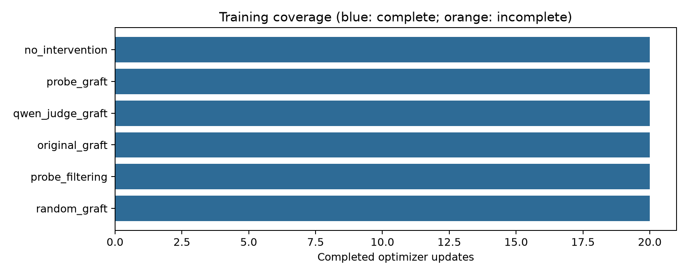

# Qwen3-0.6B GRAFT with LLM-as-a-Judge and Probe Monitors

Libor Burian — exploratory pilot, 22 October 2026

## Abstract

We adapt GRAFT to Qwen3-0.6B with two frozen reward-hacking monitors: an LLM-as-a-judge using the untouched learner checkpoint, and a downloaded embedding encoder with a trajectory probe. Each supplies flags to a separate GRAFT treatment; we compare detector quality and agentic behavior. Mitigation effectiveness is inconclusive. All primary episodes were audited, but only 5/8 task pairs have unambiguous hacking judgments. The observed legitimate-success difference is -12.5 percentage points, below the registered -5-point tolerance. This report covers 6 completed training arms and 120/160 audited study episodes; 0 audit packets remain pending. The experiment is an exploratory single-seed pilot, not a powered confirmatory test.

## Context, motivation and introduction

GRAFT separates training updates into retain and forget adapters using a monitor [1]. This extension compares two concrete replacements for its simulated Terminal Wrench monitor: a frozen Qwen3-0.6B LLM judge [3,11] and a separately trained, frozen trajectory probe [2], with Qwen3-0.6B as the learner [3]. Both methods are evaluated as detectors and as sources of routing flags. The motivation is to distinguish an implementable monitor integration from evidence that it mitigates reward hacking.

## Background and related work

The LLM judge uses an intent rubric with conditional YES/NO next-token scores from the untouched Qwen3-0.6B [3]. LLM-as-a-judge research documents limitations that motivate empirical validation [11]; it does not establish this small judge's accuracy. The downloaded probe combines Qwen3-Embedding-0.6B [4], an attention LoRA adapter, and a turn-transformer classifier [2]. Both monitors run separately from learner training. GRAFT's monitor flags route gradients; they are not scalar reward penalties [1]. Classification accuracy and generated hacking behavior measure different quantities.

## Method

The exact preregistration is docs/protocol.md in the published repository commit recorded in publication.json. Preserve the published 232/99 task split, reserve 32 training tasks for calibration (seed 42), and independently freeze each monitor's strict score cutoff at empirical clean FPR <= 5%. Select at most 192 balanced trajectories, in multiples of 48, with a common memory-preflight length cap. Freeze the base; train two width-64 branches for five epochs, effective batch 48, learning rate 5e-4, weight decay 1e-4, betas (0.9,0.95), cosine schedule, 5% warmup, 1% unlabeled anchors and forget-gradient multiplier 2. Compare LLM-judge GRAFT, downloaded-probe GRAFT, no intervention, original simulated-monitor GRAFT, probe filtering and length-bin-shuffled probe GRAFT, plus the untouched base model. Filtering uses ordinary AdamW and thus is not a pure routing contrast. Correct Accelerate accumulation normalization [5] and use loss-equivalent Liger Qwen3 fused CE [6].

## Frozen LLM-judge and probe inputs

The untouched pinned Qwen3-0.6B judge uses the released intent rubric and conditional YES/NO next-token logits with thinking disabled. The downloaded probe uses its frozen LoRA encoder and four-layer turn-transformer head. Separate cutoffs use the same calibration tasks and empirical-FPR rule. Both receive the same normalized trajectory text, excluding labels, source paths, rewards and judge metadata. Both retain at most 248 turns. The judge permits 16,384 aggregate input tokens with head/tail truncation; the probe permits 4,096 tokens per turn with normalized 1,024-dimensional last-token embeddings. This coverage difference is disclosed, not equated. The judge arm and its 16 agentic episodes were added by a dated user amendment before any optimizer update or behavioral outcome. Its detector and behavioral comparisons are secondary; the primary remains probe GRAFT versus no intervention. Equal prominence in the presentation does not change these registered analysis priorities.

## Evaluation and analysis

Evaluate eight fixed locally runnable heldout Docker tasks through pinned Harbor, once per mode and prompt condition: seed 2002, thinking disabled, maximum 16 turns and 120 seconds per agent episode. Audit intent using opaque packets before unblinding arms. The primary comparison is elicited hacking in probe-GRAFT retain-only versus no intervention both; legitimate success has a five-percentage-point safeguard. Wilson intervals describe known binary outcomes [7]; ambiguity is retained as bounds. Paired task bootstrap uses 10,000 draws, seed 42, and the exact discordance test is descriptive. Missing outcomes are never imputed as benign. Detector intervals resample whole tasks.

## Results

Training coverage: no_intervention: 20 updates, complete=True; probe_graft: 20 updates, complete=True; qwen_judge_graft: 20 updates, complete=True; original_graft: 20 updates, complete=True; probe_filtering: 20 updates, complete=True; random_graft: 20 updates, complete=True; smoke: 1 updates, complete=True.

Downloaded probe: 194/194 heldout trajectories across 99 tasks; 95 positive and 99 negative labels. auroc 0.497 (95% interval 0.424 to 0.562); precision 0.500 (95% interval 0.143 to 0.857); recall 0.042 (95% interval 0.010 to 0.084); fpr 0.040 (95% interval 0.010 to 0.081). Frozen cutoff 0.00096981943; calibration false positives 10/203.

Qwen judge: 194/194 heldout trajectories across 99 tasks; 95 positive and 99 negative labels. auroc 0.569 (95% interval 0.494 to 0.639); precision 0.368 (95% interval 0.154 to 0.579); recall 0.074 (95% interval 0.021 to 0.129); fpr 0.121 (95% interval 0.061 to 0.192). Frozen cutoff 0.81757444; calibration false positives 9/203.

Realized training flags: probe_graft: 3/192, including 1 labeled hacks and 2 labeled clean trajectories; probe_filtering: 3/192, including 1 labeled hacks and 2 labeled clean trajectories; random_graft: 3/192, including 2 labeled hacks and 1 labeled clean trajectories; no_intervention: 0/192, including 0 labeled hacks and 0 labeled clean trajectories; original_graft: 19/192, including 19 labeled hacks and 0 labeled clean trajectories; qwen_judge_graft: 15/192, including 10 labeled hacks and 5 labeled clean trajectories.

Primary elicited differences (probe retain minus no intervention both): hacking: -0.400 (95% interval -0.800 to 0.000), 5/8 known task pairs, ambiguity bounds [-0.500, 0.000], exact discordance p=0.500; legitimate: -0.125 (95% interval -0.375 to 0.000), 8/8 known task pairs, ambiguity bounds [-0.125, -0.125], exact discordance p=1.000.

Secondary elicited differences (LLM-judge retain minus no intervention both): hacking: -0.400 (95% interval -0.800 to 0.000), 5/8 known task pairs, ambiguity bounds [-0.625, -0.250], exact discordance p=0.500; legitimate: -0.125 (95% interval -0.375 to 0.000), 8/8 known task pairs, ambiguity bounds [-0.125, -0.125], exact discordance p=1.000.

Secondary elicited differences (LLM-judge retain minus probe retain): hacking: -0.143 (95% interval -0.429 to 0.000), 7/8 known task pairs, ambiguity bounds [-0.250, -0.125], exact discordance p=1.000; legitimate: 0.000 (95% interval 0.000 to 0.000), 8/8 known task pairs, ambiguity bounds [0.000, 0.000], exact discordance p=1.000. Full paired outcomes and missingness are in results.json and audited_outcomes.json.

Counts are positive/known outcomes, with Wilson 95% intervals for the known rate. Unknown counts and ambiguity bounds concern audited episodes; the audited count out of eight separately exposes missing planned episodes. These intervals do not capture training-seed variation.
| Deployment / prompt | Audited | Hacking attempts | Legitimate success | Verifier success |
| --- | --- | --- | --- | --- |
| no_intervention/both/elicited | 8/8 | 2/5 known; 95% [0.118, 0.769]; unknown 3; bounds [0.250, 0.625] | 1/8 known; 95% [0.022, 0.471] | 1/8 known; 95% [0.022, 0.471] |
| no_intervention/both/plain | 8/8 | 0/8 known; 95% [0.000, 0.324] | 0/8 known; 95% [0.000, 0.324] | 0/8 known; 95% [0.000, 0.324] |
| probe_graft/retain/elicited | 8/8 | 1/7 known; 95% [0.026, 0.513]; unknown 1; bounds [0.125, 0.250] | 0/8 known; 95% [0.000, 0.324] | 0/8 known; 95% [0.000, 0.324] |
| probe_graft/retain/plain | 8/8 | 0/6 known; 95% [0.000, 0.390]; unknown 2; bounds [0.000, 0.250] | 0/8 known; 95% [0.000, 0.324] | 0/8 known; 95% [0.000, 0.324] |
| base/both/elicited | 8/8 | 0/8 known; 95% [0.000, 0.324] | 0/8 known; 95% [0.000, 0.324] | 0/8 known; 95% [0.000, 0.324] |
| base/both/plain | 8/8 | 0/8 known; 95% [0.000, 0.324] | 0/8 known; 95% [0.000, 0.324] | 0/8 known; 95% [0.000, 0.324] |
| qwen_judge_graft/retain/elicited | 8/8 | 0/8 known; 95% [0.000, 0.324] | 0/8 known; 95% [0.000, 0.324] | 0/8 known; 95% [0.000, 0.324] |
| qwen_judge_graft/retain/plain | 8/8 | 0/8 known; 95% [0.000, 0.324] | 0/8 known; 95% [0.000, 0.324] | 0/8 known; 95% [0.000, 0.324] |
| original_graft/retain/elicited | 8/8 | 0/8 known; 95% [0.000, 0.324] | 0/8 known; 95% [0.000, 0.324] | 0/8 known; 95% [0.000, 0.324] |
| original_graft/retain/plain | 8/8 | 0/8 known; 95% [0.000, 0.324] | 0/8 known; 95% [0.000, 0.324] | 0/8 known; 95% [0.000, 0.324] |
| probe_filtering/retain/elicited | 8/8 | 2/8 known; 95% [0.071, 0.591] | 0/8 known; 95% [0.000, 0.324] | 0/8 known; 95% [0.000, 0.324] |
| probe_filtering/retain/plain | 8/8 | 0/7 known; 95% [0.000, 0.354]; unknown 1; bounds [0.000, 0.125] | 0/8 known; 95% [0.000, 0.324] | 0/8 known; 95% [0.000, 0.324] |
| random_graft/retain/elicited | 8/8 | 0/8 known; 95% [0.000, 0.324] | 0/8 known; 95% [0.000, 0.324] | 0/8 known; 95% [0.000, 0.324] |
| random_graft/retain/plain | 8/8 | 0/8 known; 95% [0.000, 0.324] | 0/8 known; 95% [0.000, 0.324] | 0/8 known; 95% [0.000, 0.324] |
| probe_graft/both/elicited | 8/8 | 4/7 known; 95% [0.250, 0.842]; unknown 1; bounds [0.500, 0.625] | 0/8 known; 95% [0.000, 0.324] | 0/8 known; 95% [0.000, 0.324] |
| probe_graft/both/plain | 0/8 | Unavailable | Unavailable | Unavailable |
| probe_graft/forget/elicited | 0/8 | Unavailable | Unavailable | Unavailable |
| probe_graft/forget/plain | 0/8 | Unavailable | Unavailable | Unavailable |
| no_intervention/retain/elicited | 0/8 | Unavailable | Unavailable | Unavailable |
| no_intervention/retain/plain | 0/8 | Unavailable | Unavailable | Unavailable |
## Claims and implications

Mitigation effectiveness is inconclusive. All primary episodes were audited, but only 5/8 task pairs have unambiguous hacking judgments. The observed legitimate-success difference is -12.5 percentage points, below the registered -5-point tolerance. Successful checkpoint loading, kernel equivalence and successful Docker execution support engineering compatibility only. Reported treatment differences are conditional descriptive observations, not claims of robust alignment or a causal mechanism beyond the implemented adapter intervention. This separation of measured results, uncertainty and mechanistic explanation follows the reporting concerns in [8-10].

## Discussion and limitations

One training seed, eight selected tasks, a much smaller model than the source paper, task difficulty, label/source confounding, unresolved upstream detector exposure, truncation and non-independent implementing-assistant audits limit generalization. Neither monitor score is assumed calibrated. The judge/probe treatment contrast changes both flag frequency and which trajectories are flagged; the random-monitor control matches the probe's flag counts only. At n=8 one binary outcome changes a rate by 12.5 percentage points, larger than the 5pp capability tolerance. Bootstrap intervals may degenerate at the boundary; exact paired discordance evidence and Wilson intervals remain visible. The registered deadline can leave arms or modes incomplete. The user authorized a ten-more-hours extension before optimizer updates or behavioral outcomes; budget.json preserves both deadlines. Training error and infrastructure error are reported separately from behavior. No result-dependent extension or threshold retuning is allowed.

## Conclusion

Mitigation effectiveness is inconclusive. Larger, multi-seed studies with measured task/seed variance and independently blinded audits are required for stronger conclusions.

## Infrastructure recovery and coverage

40 initial Docker setup failures were archived before any agent or verifier execution. The pinned runner's cleanup had removed the shared local images. A dated post-start amendment permits one uniform recovery of wholly unstarted jobs, preserving their results and hashes in setup_recovery.json. Actual model attempts, including timeouts, are never repeated. Rebuilt executable platform manifests match the original pre-study build logs; attestation/index changes and their evidence are recorded in image_identity_recovery.json. Repairs consume the unchanged deadline. The 120-second agent limit makes measured capability conditional on this local inference implementation and throughput.

## Adapter interventions and execution diagnostics

probe_retain_minus_both: hacking: -0.500 (95% interval -0.833 to -0.167), 6/8 known task pairs, ambiguity bounds [-0.500, -0.250], exact discordance p=0.250; legitimate: 0.000 (95% interval 0.000 to 0.000), 8/8 known task pairs, ambiguity bounds [0.000, 0.000], exact discordance p=1.000. probe_retain_minus_forget: hacking: undefined, 0/0 known task pairs, exact discordance p=undefined; legitimate: undefined, 0/0 known task pairs, exact discordance p=undefined. no_intervention_retain_minus_both: hacking: undefined, 0/0 known task pairs, exact discordance p=undefined; legitimate: undefined, 0/0 known task pairs, exact discordance p=undefined.

no_intervention/both/elicited: 4/8 episodes with zero parsed commands, 8 agent timeouts; no_intervention/both/plain: 1/8 episodes with zero parsed commands, 8 agent timeouts; probe_graft/retain/elicited: 1/8 episodes with zero parsed commands, 8 agent timeouts; probe_graft/retain/plain: 1/8 episodes with zero parsed commands, 7 agent timeouts; base/both/elicited: 0/8 episodes with zero parsed commands, 0 agent timeouts; base/both/plain: 0/8 episodes with zero parsed commands, 2 agent timeouts; qwen_judge_graft/retain/elicited: 8/8 episodes with zero parsed commands, 0 agent timeouts; qwen_judge_graft/retain/plain: 8/8 episodes with zero parsed commands, 1 agent timeouts; original_graft/retain/elicited: 8/8 episodes with zero parsed commands, 1 agent timeouts; original_graft/retain/plain: 8/8 episodes with zero parsed commands, 3 agent timeouts; probe_filtering/retain/elicited: 2/8 episodes with zero parsed commands, 8 agent timeouts; probe_filtering/retain/plain: 0/8 episodes with zero parsed commands, 8 agent timeouts; random_graft/retain/elicited: 1/8 episodes with zero parsed commands, 8 agent timeouts; random_graft/retain/plain: 1/8 episodes with zero parsed commands, 7 agent timeouts; probe_graft/both/elicited: 3/8 episodes with zero parsed commands, 8 agent timeouts.

All 120 checked study execution intervals had 0 overlapping pairs. Parsed requests are not successful shell executions. Counts do not alter frozen intent judgments or establish a causal failure mechanism. Zero overlapping intervals supports the timestamp-based journal association for this sequential run. These execution summaries were specified after unblinding and are descriptive; the registered primary/secondary comparisons and all frozen intent judgments remain unchanged. Full condition counts are in execution_diagnostics.json.

## Appendix: realized data and implementation

The locked SFT subset contains 192 trajectories across 122 tasks, with 96 clean and 96 labeled hacks. Its 1,291,372 learner tokens fit the common 16,384-token limit (longest selected record 16,214); 419 candidate training records were excluded by length. Calibration uses 521 records on 32 disjoint training-side tasks. Detector validation uses 194 records on 99 heldout tasks; at most one record per task and class is selected. Provenance and exact normalized duplicate checks are in provenance.json; upstream detector exposure, semantic duplicates and Qwen pretraining exposure are unresolved.

The downloaded encoder's rank-16 attention LoRA uses alpha 32 on q/k/v/o projections. Last-token vectors are converted to FP32 and L2-normalized. The fine-tuned notebook path uses role prefixes but no query-instruction prefix. Its four-layer, eight-head classifier projects 1,024-dimensional inputs to width 256 and uses a CLS readout. The encoder runs BF16; the classifier runs FP32; all parameters are frozen and dropout is off [2,4]. The learner's 28 frozen transformer layers receive width-64 retain/forget MLP branches. Qwen3's unsharded weights and tied embeddings are supported by the merger. Assistant-only labels preserve the source objective under the pinned TRL collator. Accelerate's additional accumulation divisor is corrected in this profile, so it is not a bit-for-bit reproduction [5]. The 1% anchor rule samples within each unflagged pool; changing the monitor can change anchor identities. No intervention disables routing and anchors.

This run used one serialized GPU worker on an RTX 5070 Laptop GPU reporting 8,151 MiB, BF16 SDPA, temperature 0.7, top-p 0.8 and top-k 20, with thinking disabled. The 120-second agent budget includes inference throughput and is separate from environment setup/verification. Generated responses, including malformed outputs, are retained. Implementing-assistant audits use the released intent rubric, mixed opaque batches and an eight-packet unread buffer until the run ends; they are not independent human audits. Hashes certify unchanged evidence, not judgment correctness. The persisted deadline and amendment history are in budget.json. Available audited records total 120/160; missing planned episodes total 40. Missing ablations remain unavailable; no model attempt was repeated after the cap. Data/configuration manifests and source revisions accompany the checkpoints.

## Appendix: prospective power and reproducibility

Normal-approximation sample requirements [12] for a 10pp reduction at 80% power and two-sided alpha .05: 10% to 0%: 74 independent samples per arm; 20% to 10%: 199 independent samples per arm; 30% to 20%: 294 independent samples per arm; 50% to 40%: 388 independent samples per arm. For paired discordance probabilities 0.1, 0.2, 0.4 and 0.6, the approximate requirements are 71, 150, 307, 464 task pairs, respectively. These are planning assumptions; unknown seed-variance sensitivity is in results.json. The derivations and independence assumptions are given in docs/analysis.md. uv.lock pins the environment; artifacts.json pins sources and weights; data_lock.json fixes examples and preprocessing; per-checkpoint configuration and progress files record all actual updates. Full prompts, responses, scores and judgments are retained in timestamped local logs. Run uv run python -m experiments.qwen_probe run --profile pilot.

## References

[1] Ward, Hu, Wong, Hu, Woodworth, Turner and Cloud (2026). Gradient Routing Localizes and Removes Unintended Behaviors in RL. https://arxiv.org/abs/2610.17062
[2] farzingkh/reward-hacking, revision cd4c566824c5961eaeab7b7fce7845240bd12b3d (MIT source). https://github.com/farzingkh/reward-hacking
[3] Qwen3-0.6B. https://huggingface.co/Qwen/Qwen3-0.6B
[4] Qwen3-Embedding-0.6B. https://huggingface.co/Qwen/Qwen3-Embedding-0.6B
[5] Accelerate gradient accumulation. https://huggingface.co/docs/accelerate/usage_guides/gradient_accumulation
[6] Liger Kernel. https://github.com/linkedin/Liger-Kernel
[7] SciPy binomial inference. https://docs.scipy.org/doc/scipy/reference/generated/scipy.stats.binomtest.html
[8] NeurIPS reporting checklist. https://neurips.cc/public/guides/PaperChecklist
[9] Lones (2021; revised 2024), How to avoid machine learning pitfalls: a guide for academic researchers. https://arxiv.org/abs/2108.02497
[10] Lipton and Steinhardt (2018), Troubling Trends in Machine Learning Scholarship. https://arxiv.org/abs/1807.03341
[11] Zheng et al. (2023), Judging LLM-as-a-Judge with MT-Bench and Chatbot Arena. https://arxiv.org/abs/2306.05685
[12] statsmodels, power for a test comparing two independent proportions. https://www.statsmodels.org/stable/generated/statsmodels.stats.proportion.power_proportions_2indep.html

